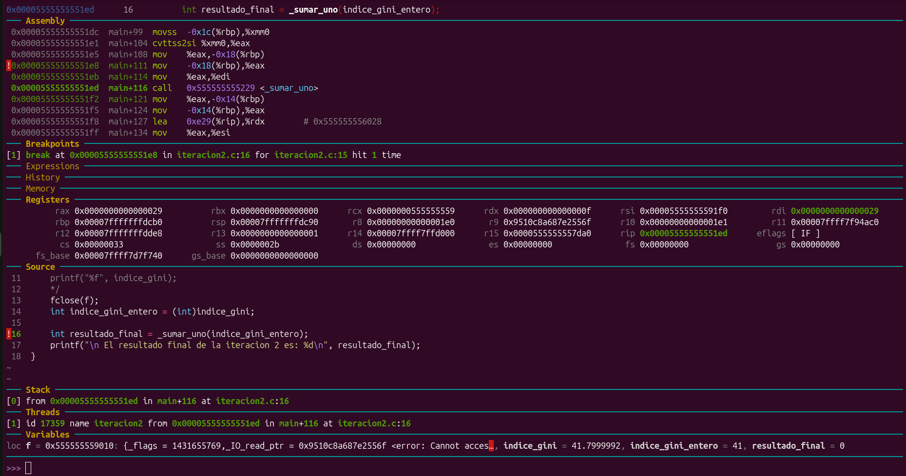
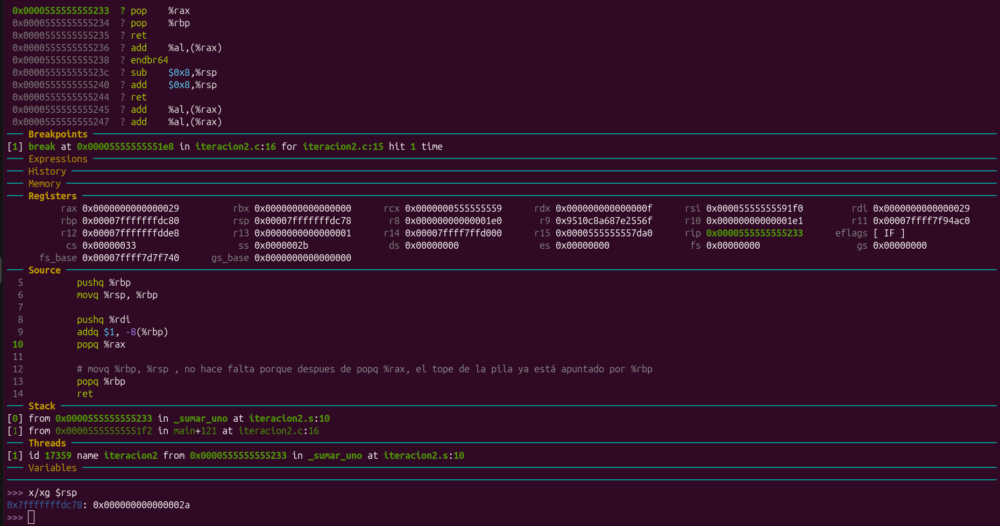
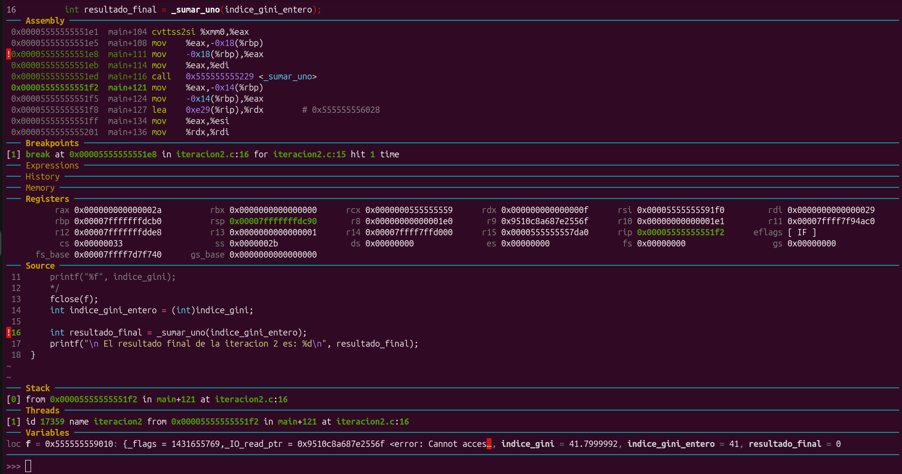

# TP2_SdC

## Integrantes del grupo

    - Abad Iñaki Manuel
    - Mensi Spachessi Valentín

## Descripción

El trabajo se dividió en dos iteraciones. En la primera se obtuvo el índice de Gini de Argentina mediante la API del Banco Mundial, utilizando un ejemplo de libcurl para realizar una petición HTTP. En la segunda se recuperó el dato almacenado y se procesó mediante una subrutina escrita en ensamblador x86-64, llamada desde C.

## Iteración 1 — Obtención del dato

Para realizar la petición HTTP se tomó como base el ejemplo `getinmemory` de libcurl, que permitió recibir la respuesta del servidor y almacenarla en memoria.

A partir de este ejemplo, se adaptó el programa para consultar el índice de Gini de Argentina correspondiente al período 2011–2020. La respuesta obtenida se guardó en el archivo `dato.txt`, ubicado en el directorio de esta iteración, para que pudiera utilizarse posteriormente.

## Iteración 2 — Procesamiento en C y Assembly

En esta iteración se leyó el valor almacenado en `../iteracion_1/dato.txt` mediante `fscanf`. El dato se guardó en una variable de tipo `float` y luego se convirtió a `int`, descartando su parte decimal.

A continuación, se llamó desde C a la subrutina `_sumar_uno`, implementada en ensamblador x86-64. La rutina recibió como parámetro el valor ya convertido a entero en %rdi. Luego utilizó la pila para guardarlo, incrementarlo en uno y devolver el resultado en `rax`, que se utilizó como valor de retorno de la función. Además, la rutina implementó un prólogo y epílogo típicos de la convención de llamadas vistos en clase. 

Finalmente, el programa imprimió el resultado obtenido.

## Depuración

Durante el desarrollo se utilizó **GDB** para depurar el programa y analizar la ejecución de las instrucciones en ensamblador. Se emplearon herramientas de inspección de registros antes, durante y después de la ejecución del a subrutina escrita en ensamblador.

A continuación se presentan algunas capturas de la depuración y un análisis del proceso:

`0x00005555555551f2` es la dirección de retorno que se guardará en el stack

Se observa que el dato fue guardado en el tope de la pila

Al regresar, `rip` apunta a la dirección de retorno de la función.

En la Figura 1 se muestra el estado de la depuración antes de entrar a la función _sumar_uno. En ella se observa que la direccion de retorno de la función será `0x00005555555551f2`, es decir, la dirección de la instrucción siguiente a la que corresponde al breakpoint (call _sumar_uno). Una vez dentro de la función, la Figura 2 evidencia cómo el dato, pasado como parámetro, queda guardado en el tope de la pila, ya habiéndose incrementado en 1 (salida 0x2a del comando x/xg $rsp en GDB). Finalmente, la Figura 3 ilustra el momento de salida en el que el registro `rip` apunta a dicha dirección de retorno.

## Tecnologías utilizadas

- C
- Assembly x86-64
- libcurl
- GCC
- GDB
- API REST del Banco Mundial

## Fuente de datos

[API del Banco Mundial — Índice de Gini de Argentina (2011–2020)](https://api.worldbank.org/v2/country/ARG/indicator/SI.POV.GINI?date=2011:2020&format=json)

